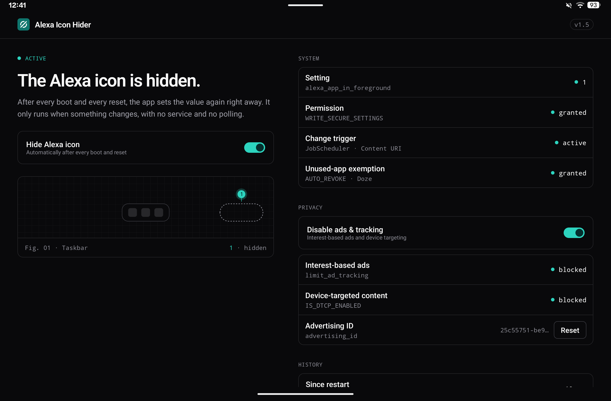

# Alexa Icon Hider

Permanently hides the Alexa button (`AlexaIngressButton`) in the Fire Launcher taskbar on the Amazon Alexa Tablet 12 Pro. No root required. The APK is around 57 KB, ships without AndroidX or third-party libraries, and runs with no background service, no polling, and no wakelocks.



## Features

- **Hides the Alexa button** in the Fire Launcher taskbar, including after the two resets SystemUI performs on every boot.
- **Event-driven.** It runs only when the setting changes — no background service, no polling, no wakelocks.
- **On/off switch** with loop protection: if another process keeps resetting the value, the app turns itself off instead of fighting forever.
- **Privacy section** that disables interest-based ads (`limit_ad_tracking`) and device-targeted content (`IS_DTCP_ENABLED`), and resets the advertising ID through Amazon's own ad ID service.
- **Status screen** with a run history since boot and copyable `adb` commands for any missing permission.

## Compatibility

- **Tested on the Amazon Alexa Tablet 12 Pro** (ATSPWI) with Alexa Tablet UI 16.1.10 (Android 16, API 36) and Fire Launcher (Home UI) 1.0.21178.0.
- **Requires** Android 16 (`minSdk 36`). It will not install on older Fire tablets running Fire OS 7 or 8.
- **Not tested** with the Alexa app enabled and in use — that case is covered by [loop protection](#features), which turns the app off rather than fighting SystemUI forever.

## How it works

The Fire Launcher shows the Alexa button only while `alexa_window_is_open` and `alexa_app_in_foreground` are both `0`. It observes both values live, so the change takes effect without a restart (measured at ~44 ms from write to hidden).

SystemUI resets `alexa_app_in_foreground` back to `0` twice on every boot. The app writes `1` again after each reset using a direct-boot-aware `BootReceiver` and a `JobScheduler` trigger that fires only when the value changes. If another process keeps resetting the value, loop protection turns the app off after 10 writes within 60 seconds.

## Download

The signed APK is published on the [Releases](https://github.com/Sujant-h/alexa-icon-hider/releases) page as `alexa-icon-hider-<version>.apk`, next to its `.sha256` checksum.

Verify the checksum:

```bash
sha256sum alexa-icon-hider-1.5.apk
```

On Windows, use `certutil -hashfile alexa-icon-hider-1.5.apk SHA256`.

Every release is signed with the same key (`CN=minnallab`), so updates only install over an existing app when the key matches:

```
SHA-256: 24b85f093c4ddda288d8be50cd7484a7cbc04477fcfc2cd4db19a2ab5f21d33e
```

## Installation

Requires `adb` with USB or wireless debugging. On the Alexa Tablet 12 Pro your user is `10`; check with `adb shell am get-current-user` and replace `10` below on other devices.

**1. Install the APK:**

```bash
adb install --user 10 alexa-icon-hider-1.5.apk
```

**2. Grant the write permission (required):**

```bash
adb shell pm grant --user 10 com.minnallab.alexaiconhider android.permission.WRITE_SECURE_SETTINGS
```

**3. Allow notifications:**

```bash
adb shell pm grant --user 10 com.minnallab.alexaiconhider android.permission.POST_NOTIFICATIONS
```

**4. Exempt the app from unused-app hibernation and battery limits:**

```bash
adb shell "cmd appops set --user 10 com.minnallab.alexaiconhider AUTO_REVOKE_PERMISSIONS_IF_UNUSED ignore && dumpsys deviceidle whitelist +com.minnallab.alexaiconhider"
```

Without this, Android hibernates the app after a few months unused, stops it, and the icon returns after the next restart.

**5. Open the app once:**

```bash
adb shell am start --user 10 -n com.minnallab.alexaiconhider/.MainActivity
```

A freshly installed app is in the "stopped" state and receives no boot broadcasts until it has been opened once.

### Permissions

- `WRITE_SECURE_SETTINGS` — to write the setting (granted once via adb).
- `RECEIVE_BOOT_COMPLETED` — granted automatically at install time.
- `POST_NOTIFICATIONS` — for the permission-missing hint and the loop-protection notification.

## Uninstall

Uninstall it like any other app: **Settings → Apps → Alexa Icon Hider → Uninstall**, or long-press the app icon and choose **Uninstall**.

If the switch is still on when you uninstall, the Alexa button returns after the next restart — or turn the switch off first to bring it back right away.

Alternatively, uninstall via adb:

```bash
adb shell pm uninstall --user 10 com.minnallab.alexaiconhider
```

## License

[MIT](LICENSE), © 2026 minnallab. Not affiliated with Amazon. "Alexa" and "Fire" are trademarks of Amazon.com, Inc. or its affiliates.
